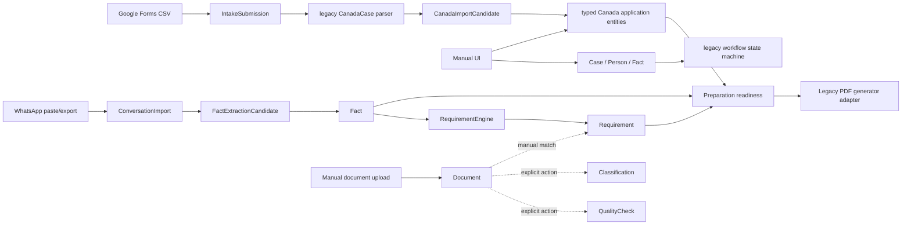
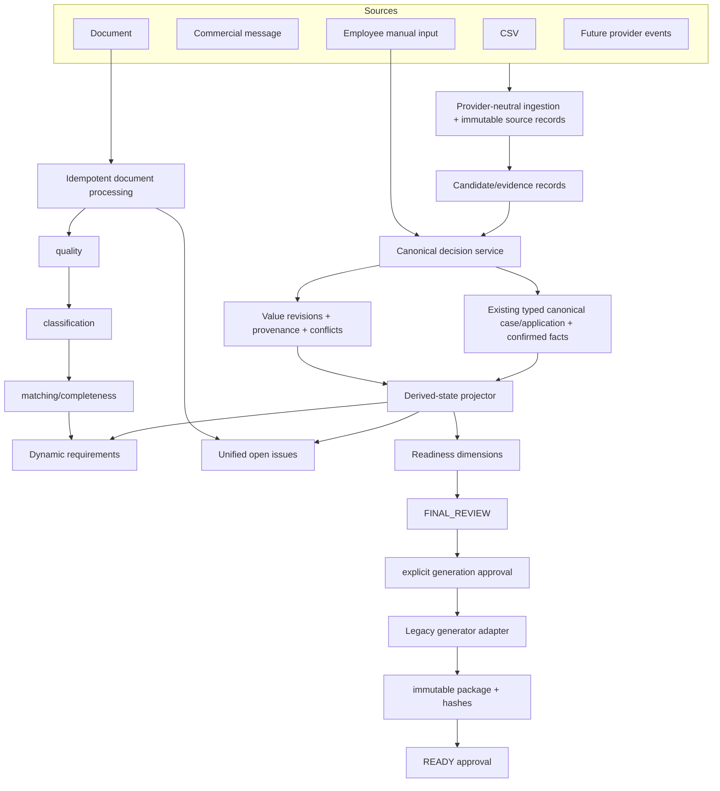

# Dynamic case management — Phase 0 architecture review

Date: 2026-10-12  
Reviewed baseline: `main` at `a6ed046`  
Working branch: `codex/dynamic-case-phase-0`

## Executive decision

The existing `Case` and typed Canada application tables remain the only
authoritative case/application model. The implementation must extend those
tables and the existing candidate/provenance services; it must not introduce a
parallel review application whose JSON payload becomes a second source of
truth.

Operational work must be independent of completeness. A case may be created
and processed while facts, typed application fields, documents, and decisions
are missing. Completeness gates are applied only when entering final review,
generating an official package, approving it as ready, or recording submission.

The unmerged branch `origin/codex/import-review-stabilization` contains useful,
tested fixes for atomic section confirmation and stale candidate target
recovery. Those fixes should be ported selectively. Its
`CanadaTrvReviewApplication`/`CanadaTrvReviewField` persistence model must not be
merged as-is because it duplicates the existing import-candidate, canonical
entity, provenance, and review-state responsibilities.

## Investigation scope and verified baseline

The required backend services, models, schemas, routes, migrations, frontend
components, legacy Canada package, and tests were inspected. The repository has
no `AGENTS.md` with additional instructions.

Executed against the reviewed baseline:

- `PYTHONPATH=. .venv/bin/pytest -q backend/tests tests`: **460 passed**, 6
  dependency deprecation warnings.
- `npm test -- --run`: **62 passed** across 13 files.
- `npm run build`: **passed**, including TypeScript and static page generation.

These results establish regression health for the current behavior. They do not
validate the requested dynamic lifecycle, unified issues, automatic document
pipeline, transactional section confirmation, or final-review-first generation,
because those behaviors do not yet exist in the baseline.

The reported customer CSV is not present in the repository. The exact original
production exception therefore cannot be reproduced from that file. Root causes
below are based on the current code, its history, synthetic fixtures, and the
four reported values.

## Current architecture

### Existing authoritative stores

| Concern | Current authority | Assessment |
| --- | --- | --- |
| Case identity and business state | `cases` | Reuse. `purpose` currently mixes a placeholder/intake summary with application purpose. |
| People and operational roles | `persons` plus `case_person_roles` | Reuse `case_person_roles` as authority; `persons.roles` is a compatibility projection. |
| Typed Canada application data | `canada_applications` and related typed tables | Reuse as canonical authority. |
| Sponsor/host/trip-payer decisions | confirmed rows in `facts` | Reuse initially, but expose through a canonical field service and add explicit unknown/revision semantics. |
| CSV proposals | `canada_import_candidates` | Reuse as candidate/evidence records. |
| WhatsApp proposals | `fact_extraction_candidates` | Reuse, behind a shared candidate-review contract. |
| Canonical provenance/review | `field_provenance_reviews` | Reuse and extend with value revisions and source linkage. |
| Documents | `documents` plus quality/classification/match tables | Reuse, adding ingestion/processing attempts and remediation issues. |
| Derived document requirements | `requirements` | Reuse; deactivate/reactivate rather than delete. |
| Final package | `preparation_runs` and artifacts | Reuse; add explicit generation/final approvals. |
| Legacy generator input | root `canada.CanadaCase` dataclass | Keep only as an adapter boundary, never as case authority. |

### Current end-to-end flow

1. CSV receipt persists a source object and `IntakeSubmission`.
2. Intake resolves an explicitly selected/deterministically linked case or
   creates a partial placeholder case (`services/intake.py:98-249,404-437`).
3. The verified legacy reader creates a `CanadaCase`; the import service maps
   its values into `CanadaImportCandidate` rows
   (`services/canada_imports.py:189-374`).
4. Safe candidates may be applied automatically; reviewed candidates are
   applied in one batch transaction (`services/canada_imports.py:708-767`).
5. Canonical values are persisted in the typed Canada tables, and
   `FieldProvenanceReview` rows capture the active source/review state
   (`services/canada_imports.py:804-835,1188-1207`).
6. WhatsApp follows a separate candidate path and confirms values into generic
   `Fact` rows (`services/conversations.py:109-282`).
7. Confirmed facts drive conditional requirements
   (`services/requirements.py:157-286`).
8. Preparation readiness reads typed canonical entities, facts, unresolved
   candidates, provenance, and requirements
   (`services/canada_preparation.py:57-520`).
9. The current workflow requires `INTAKE -> DOCUMENTS -> PREPARE -> REVIEW ->
   READY -> SUBMITTED`; PDF generation happens in `PREPARE`, before `REVIEW`
   (`services/workflow.py:20-239`, `services/preparation_runs.py:74-167`).

## Reusable functionality

- Durable CSV receipt, source hashing, source storage, retry attempts,
  deterministic explicit case association, and duplicate handling in
  `IntakeService`.
- Versioned Google Forms parsing and the audited legacy-to-canonical mapping.
- Candidate conflict detection that preserves a confirmed canonical value.
- Typed canonical Canada entities and the legacy generator adapter.
- Field provenance, import entity links, workflow transition history, and audit
  events.
- Provider interfaces for fact extraction, quality evaluation, classification,
  storage, and official form generation.
- Requirement deactivation/reactivation and completeness evaluation without
  deleting historical matches or events.
- Document file signature/size checks, isolated quality attempts, classification
  attempts, manual review, compatibility matching, and artifact integrity hashes.
- Authentication, permission classification, final workflow authorization, and
  audit middleware.
- Partial/empty case creation and source-first entry controls already present in
  `NewCaseForm`.

## Duplicated or competing implementations

1. **Generic facts versus typed canonical fields.** Sponsor/host/payer use
   `Fact`; most application values use typed Canada tables. This split is
   acceptable only behind one canonical-field/review service. Direct UI/service
   writes currently bypass a shared revision/provenance contract.
2. **CSV candidates versus WhatsApp candidates.** They have separate tables,
   statuses, review APIs, and application logic. Preserve source-specific
   payloads but unify their decision service and conflict semantics.
3. **Legacy `CanadaCase` versus typed canonical Canada entities.** The legacy
   object is still the CSV/parser and PDF adapter format. It must remain an
   anti-corruption boundary, not regain authority.
4. **`persons.roles` versus `case_person_roles`.** The latter is authoritative;
   the former is a compatibility projection and must not independently drive
   decisions.
5. **Frontend readiness rules versus backend readiness.** The case page builds a
   partial attention count locally and therefore omits several backend issue
   classes (`CaseDetailClient.tsx:61-76`). Replace this with a backend issue
   projection.
6. **Unmerged schema-review branch.** Its four new review tables duplicate
   `IntakeSubmission`, `CanadaLegacyImportRun`, `CanadaImportCandidate`, typed
   canonical entities, and `FieldProvenanceReview`. Do not adopt those tables.

## Confirmed defect causes

### 1. Canonical confirmation fails for City, Passport Number, Identity Number, and Purpose

The last `main` commit repaired part of this path, but the underlying class of
failure remains possible.

- Newly created canonical targets are assigned to an in-memory candidate in
  `_apply_candidate` (`canada_imports.py:804-811`), but there is no durable,
  general recovery path in `confirm()` for an already-applied/same candidate
  whose `target_entity_id` is null or stale (`canada_imports.py:661-666`).
- This affects target types created during application: residential address
  (City), primary `TravelDocument` (Passport Number), and `PersonIdentifier`
  (Identity Number). A previously applied candidate can therefore show a value
  but fail with `Canonical field is unavailable for confirmation`.
- `trip.purpose` correctly targets `TripPlan.intake_purpose_text`
  (`canada_imports.py:403-413`), but confirmation is still coupled to the import
  candidate's resolvable target ID. The official `imm5257_purpose_code` is a
  separate field, which is correct and must be preserved.

Required repair: port a generalized `_canonical_entity_for_candidate` lookup,
persist target IDs after every create, verify ownership by case/application,
and add regression cases using `Campinas`, `BRTESTP000001`,
`RG-TESTE-123456789`, and `Turismo`. Never map `Turismo` to an IMM5257 code
without an employee decision.

### 2. Atomic import rollback message

Atomicity itself is correct: `apply()` wraps all accepted candidates and rolls
back on any failure (`canada_imports.py:708-765`). The reported generic message
is the final catch for failures that escape per-candidate classification.

Concrete causes visible in the current mapping path include:

- missing/stale canonical target references described above;
- placeholder values needed to satisfy non-null constraints while a multi-field
  entity is built (`PENDING-REVIEW`, `UNK`, sentinel dates in
  `canada_imports.py:1013-1068`);
- order dependencies such as host name needing to create the host before host
  address/metadata (`canada_imports.py:724-727,1077-1110`);
- constraints that can fail only on flush, after the candidate-specific call has
  returned.

The current structured field error is an improvement
(`canada_imports.py:864-897`), but errors after the candidate loop still lose
the affected field. Phase A should flush after each candidate within the same
outer transaction, attach the current candidate to any integrity error, retain
the rollback, and record safe server diagnostics with run/candidate IDs.

### 3. “Confirm section” is not a section transaction

The frontend loops over the single-field confirmation endpoint
(`CanadaImportSection.tsx:127`). Each call commits in `confirm()`
(`canada_imports.py:694,704`). If a later field fails, earlier fields stay
confirmed. The control is also disabled whenever any conflict/ambiguity exists,
instead of confirming eligible fields and returning explicit skipped fields.

Required repair: one backend bulk endpoint, row locks/revision checks, complete
pre-validation, one commit, and a result containing `confirmed`, `skipped`, and
field-specific issues. The atomic batch implementation on the unmerged branch
is a useful starting point but must be adapted to the required partial-eligibility
semantics.

### 4. Review completion is tied to the wrong abstraction

There is no authoritative `INTAKE_CONFIRMED` milestone or unified canonical
review completion service on `main`. Preparation readiness is the closest
available gate and evaluates final-form completeness, not initial intake
confirmation (`canada_preparation.py:57-520`). The import UI derives progress
only from candidates belonging to one selected import run
(`CanadaImportSection.tsx:95-130`). Consequently manual values or WhatsApp facts
cannot complete the same review milestone, and rejected proposals are presented
as confirmed in `displayStatus()`.

Required repair: derive intake/canonical readiness from canonical field
definitions and current review/provenance, independent of candidate counts or
source type.

### 5. Sponsor/host controls are missing from the normal application UI

Backend entities and endpoints exist (`create_funding_source`, `create_host`),
and the facts catalog supports explicit booleans. The normal editor exposes
counts only; it has no sponsor existence, host existence, payer mode, sponsor
identity, or host identity controls (`CanadaApplicationSection.tsx:118-152`).
Those values can currently be manipulated only through advanced generic facts
or APIs.

Required repair: normal tri-state controls (`yes`, `no`, `unknown`) using the
same canonical decision service as imported candidates, followed by conditional
funding/host editors and requirement recalculation.

### 6. Intermediate workflow gates block ordinary processing

`INTAKE -> DOCUMENTS` requires confirmed sponsor/host facts, and
`DOCUMENTS -> PREPARE` requires all blocking documents
(`workflow.py:121-145`). This makes lifecycle state stand in for completeness,
contrary to the requested model. Generation is restricted to `PREPARE`
(`preparation_runs.py:74-86`) and `PREPARE -> REVIEW` requires a current package
(`workflow.py:151-204`), which reverses the target finalization order.

Required repair: compatibility-map legacy states to `NEW/ACTIVE/FINAL_REVIEW/
READY/SUBMITTED`; allow collection/editing/document work throughout ACTIVE;
gate entry to FINAL_REVIEW on canonical and documentary prerequisites; require
explicit generation approval inside FINAL_REVIEW.

### 7. Document upload does not execute the required pipeline

Upload performs signature/MIME/size validation and persists a `Document` in
`not_checked`/`unclassified` state (`documents.py:63-115`). Quality and
classification are independent explicit API/UI actions. Classification is not
strictly quality-first, no durable processing-run state machine exists, and a
document processing failure has no provider-neutral retry/deduplication key.

Required repair: create a document receipt plus idempotent processing run with
stage attempts. Basic validation starts on receipt; quality gates
classification; classification gates matching/completeness. Manual fallback
remains available when providers are unavailable.

### 8. Open issues are incomplete and partly duplicated in React

The case page locally combines fact conflicts, pending requirements, selected
quality/classification states, and blocking tasks (`CaseDetailClient.tsx:61-76`).
It omits unconfirmed typed fields, import candidates that are merely new,
ambiguous ownership, processing failures, remediation/customer drafts, and
final-package issues. Preparation readiness has richer issues, but only for
final preparation and with different paths.

Required repair: one backend `CaseIssueProjection` with category, severity,
blocking scope, entity/field target, action, and navigation token.

### 9. Layout is intentionally capped at 1240px

`.page-shell` and header padding use a 1240px desktop cap
(`globals.css:30,41,165`). Tables protect themselves with local overflow, but
the workspace cannot use wider screens. Replace the cap with a configurable
wide workspace maximum or full-width gutters and retain local table scrolling.

### 10. Legacy diagnostics are not cleanly separated

The normal employee screen embeds legacy import runs, warnings, mapping status,
and advanced canonical diagnostics. Backend legacy-import endpoints use normal
case edit/read permissions (`authorization.py:131-150`), not an administrator
diagnostics permission. Preserve employee-facing source review, but move raw
mapping/run diagnostics behind a dedicated admin permission and route.

### 11. Optimistic concurrency is absent

Case, fact, typed Canada entity, candidate confirmation, and manual editor APIs
do not require an expected revision/ETag. `updated_at` exists on some rows but
is not used as a write precondition. Stale screens can overwrite a newer value.

Required repair: add monotonic revisions to canonical subjects and require
`expected_revision` for field decisions and mutable canonical updates.

## Target architecture

### Architectural rules

1. `Case` is source-independent and may exist empty.
2. Sources are immutable evidence; candidates never become authoritative merely
   because an import run succeeded.
3. Every canonical mutation goes through one decision service that validates
   the field, checks revision, records provenance/revision/audit, recalculates
   derived state, and marks affected packages stale.
4. A confirmed value remains authoritative when contradictory evidence arrives.
5. Missing/unknown is distinct from false/no/not-applicable.
6. Derived state is recalculable and never used as source evidence.
7. Document stages are isolated, idempotent, retryable, and provider-neutral.
8. Only FINAL_REVIEW and later states impose final completeness gates.
9. Generation is an explicitly approved action over one canonical revision.
10. Read APIs have no workflow mutation side effects. The current automatic
    regression in `PreparationService.status()` (`preparation_runs.py:267-307`)
    must become an explicit event/command.

## Data and review model

The existing typed canonical tables remain unchanged in responsibility. Add the
following concepts rather than a second application table:

- `source_records`: provider-neutral immutable envelope (source type, external
  ID, content digest, received/source timestamps, storage reference, mapping or
  provider version, case association state).
- `canonical_candidates`: a common decision envelope referencing the existing
  source-specific candidate payload (`canada_import_candidates` or
  `fact_extraction_candidates`), canonical path, original/normalized values,
  and status. This may initially be a read projection rather than a new table.
- `canonical_value_revisions`: entity/path, revision number, previous/new value
  digest, decision, actor, timestamp, source evidence link. Do not duplicate the
  current value.
- extended `field_provenance_reviews`: direct `source_record_id`, candidate ID,
  original/normalized values or digests, mapping version, and value revision.
- `case_milestones` or a derived milestone projection for `INTAKE_CONFIRMED`;
  no workflow-state dependency.
- `case_issues`: preferably a deterministic projection with optional durable
  issue/remediation instances where assignment, communication, or resolution
  history is required.
- `document_processing_runs` and stage attempts keyed by document content hash,
  pipeline version, and stage.
- `document_remediation_issues` and editable outbound drafts.
- `generation_approvals` and `final_review_approvals` tied to canonical/package
  revisions.

## Workflow compatibility design

Do not rewrite the enum in place. Introduce a versioned lifecycle contract and
an explicit compatibility mapping:

| Existing stored state | New business stage | Migration behavior |
| --- | --- | --- |
| `INTAKE` | `NEW` unless operational activity exists; otherwise `ACTIVE` | No automatic forward approval. |
| `DOCUMENTS` | `ACTIVE` | Preserve original state/history in compatibility metadata. |
| `PREPARE` | `ACTIVE` | Existing successful package remains historical; no automatic FINAL_REVIEW. |
| `REVIEW` | `FINAL_REVIEW` | Preserve only if its current package and prerequisites are valid; otherwise retain legacy state and create blockers for explicit resolution. |
| `READY` | `READY` | Preserve; verify package approval/integrity before allowing submission. Do not silently demote during read. |
| `SUBMITTED` | `SUBMITTED` | Preserve and never reopen automatically. New discrepancies become issues. |

During one compatibility release, APIs should return both `workflow_state`
(legacy) and `lifecycle_stage` (new). Existing transition URLs remain, with
legacy targets translated to commands and deprecation metadata. After clients
move, a later migration can replace the stored legacy state.

## Migration plan

All migrations are additive first and must have deterministic backfills and
rollback-safe deployment ordering.

1. **Phase A1 — review integrity**
   - Add `canonical_review_state` and `value_revision` to import candidates.
   - Add canonical revision/source linkage columns to provenance.
   - Backfill review state from active provenance; leave ambiguous rows null and
     visible as issues.
   - Add transactional bulk-confirm API.
2. **Phase A2 — concurrency and diagnostics**
   - Add revisions to mutable canonical roots/field revision table.
   - Add safe import failure/candidate diagnostics.
   - Add admin-only legacy diagnostic permission and routes.
3. **Phase B1 — lifecycle and readiness dimensions**
   - Add `lifecycle_stage` or a versioned compatibility projection.
   - Add milestone/approval records and unified issue projection.
   - Backfill stages conservatively using the table above.
4. **Phase B2 — source-independent canonical decisions**
   - Add provider-neutral source/evidence links.
   - Route manual, CSV, and message decisions through the same field service.
5. **Phase C — document processing**
   - Add content digest/receipt metadata, processing runs, stage attempts,
     remediation issues, replacement linkage, and outbound drafts.
6. **Phase D — finalization**
   - Add generation approval and final package approval records.
   - Bind preparation runs to canonical revision/hash and mark stale via events.
7. **Phase E — integration boundary**
   - Add inbound provider event and outbound delivery attempt envelopes with
     provider/external idempotency keys.

Do not deploy unmerged migration `0016_canada_trv_schema_review` as currently
written. Its review tables would establish a second application model. The
independent `canonical_review_state` idea from its successor should be rebased
onto a new migration directly after current `0015`.

## API compatibility requirements

- Preserve current case, person, fact, document, requirement, conversation,
  Canada application, import, preparation, and workflow endpoints through at
  least one compatibility release.
- Add commands rather than changing the meaning of existing endpoints silently:
  `POST /imports/{id}/confirm-section`, canonical field decision endpoints,
  issue/readiness endpoints, document processing retry/review endpoints, and
  final-review approval/generation commands.
- Keep response fields currently consumed by the frontend. Add revision,
  canonical status, issues, and lifecycle fields additively.
- Existing direct mutation endpoints must eventually delegate to the canonical
  decision service so audit/provenance/recalculation cannot be bypassed.
- Employee-facing import review remains available; raw run/mapping diagnostics
  move to admin-only endpoints.
- Keep the legacy generator adapter and artifact download contracts until
  explicit equivalence tests pass.

## Phase execution and acceptance gates

### Phase A — stabilization

Port only the useful atomic-confirm/target-recovery changes from the unmerged
branch; add the four exact regression values; fix partial section confirmation;
add sponsor/host controls; remove the 1240px workspace cap; separate legacy
diagnostics. Gate: existing suites plus focused import/UI/auth regression tests
and production build.

### Phase B — dynamic case foundation

Introduce the canonical decision service, revisions, readiness dimensions,
unified issues, tri-state decisions, and lifecycle compatibility. Gate: CSV,
message, and manual-only cases reach the same intake milestone; incomplete
ACTIVE cases remain editable and accept documents.

### Phase C — documents

Add the idempotent quality-first pipeline, remediation issues, classification
review, matching/completeness, and drafts. Gate: one failed document never
blocks processing another; replay is idempotent.

### Phase D — final review and generation

Move generation behind FINAL_REVIEW and explicit approval; bind immutable
packages to canonical revisions; require explicit package approval for READY.
Gate: no normal intake/upload action generates official forms; changed
canonical data makes a package stale without mutating SUBMITTED state.

### Phase E — integration readiness

Add provider-neutral inbound/outbound ports and idempotent event/delivery
records. No live WhatsApp/email provider or unrestricted browser automation.

## Decisions requiring product confirmation before Phase B

The technical design can proceed through Phase A without these choices. Before
Phase B, confirm:

1. whether lifecycle names must replace the stored enum immediately or may be
   exposed first as a compatibility projection (recommended);
2. which canonical fields constitute `INTAKE_CONFIRMED` for each visa type;
3. whether an explicitly rejected source proposal counts as reviewed while its
   canonical field remains missing (recommended: proposal reviewed, field still
   unresolved);
4. retention rules for raw messages/documents and whether source values may be
   stored verbatim in revision history or only by digest/reference;
5. which role may approve generation and which distinct role may approve READY.

## Phase 0 exit criteria

Phase 0 is complete when this architecture is accepted. No application code or
database migration should be merged before that acceptance. The first Phase A
change should be a small, independently reviewable stabilization PR, not a
combined implementation of Phases A–E.
